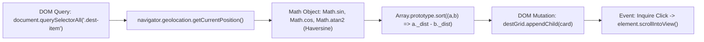

# Complete JavaScript Foundations & Project Implementation Guide

> **Target Audience:** Deepanshu Kashyap (Project Lead & Presenter)  
> **Purpose:** Quick-start JS refresher from absolute zero to project-level implementation for evaluation, viva defense, and feature demonstration.  
> **Source Files Referenced:** [`js/booking.js`](file:///c:/Users/Deepanshu/Desktop/miniproject/Hotel-Booking-Landing-Page--React-Frontend-main/js/booking.js), [`js/rooms.js`](file:///c:/Users/Deepanshu/Desktop/miniproject/Hotel-Booking-Landing-Page--React-Frontend-main/js/rooms.js), [`js/main.js`](file:///c:/Users/Deepanshu/Desktop/miniproject/Hotel-Booking-Landing-Page--React-Frontend-main/js/main.js), [`js/admin.js`](file:///c:/Users/Deepanshu/Desktop/miniproject/Hotel-Booking-Landing-Page--React-Frontend-main/js/admin.js)

---

## Part 1: Core JavaScript Fundamentals (Zero to Concept)

### 1. Variables & Data Types
In JavaScript, variables are containers used to hold data values.

```javascript
// Variable Declarations
var city = "Agra";         // function-scoped, older standard (widely supported)
let radius = 6371;         // block-scoped (lives only inside { })
const PI = Math.PI;        // constant reference (cannot be reassigned)

// Primitive Data Types
var hotelName = "The Oberoi";    // String
var pricePerNight = 18500;       // Number (handles integers and decimals)
var isAvailable = true;          // Boolean (true or false)
var userLocation = null;         // Null (intentionally empty)
var unassignedValue;             // Undefined (declared but not assigned)

// Complex Data Types
var coordinates = [27.1705, 78.0496];            // Array (ordered indexed list)
var hotel = { name: "ITC Mughal", rating: 4.8 }; // Object (key-value dictionary)
```

---
### 2. Functions & Execution
Functions are reusable blocks of code executed when invoked.

```javascript
// 1. Function Declaration
function calculateDouble(num) {
  return num * 2;
} 

// 2. Function Expression / Anonymous Function
var greetGuest = function(guestName) {
  return "Welcome, " + guestName;
};

// 3. Arrow Function (ES6)
const getKm = (m) => m / 1000;
```

---

### 3. What is the DOM (Document Object Model)?
When a web browser loads an HTML document, it converts the HTML tags into a tree structure of JavaScript objects called the **DOM**. JavaScript interacts with this tree to dynamically read, change, add, or delete elements.

```text
HTML Document
└── <html>
    ├── <head>
    └── <body>
        ├── <header>
        └── <div id="destinationsGrid">
            ├── <div class="dest-item"> ... </div>
            └── <div class="dest-item"> ... </div>
```

---

### 4. DOM Selectors (Finding HTML Elements)

```javascript
// By ID (returns single matching element or null)
var grid = document.getElementById('destinationsGrid');

// By CSS Selector (returns first matching element)
var firstButton = document.querySelector('.btn-location-detect');

// By CSS Selector (returns NodeList of ALL matching elements)
var allCards = document.querySelectorAll('.dest-item');
```

---

### 5. DOM Manipulation (Changing the Page)

```javascript
// 1. Changing text or inner HTML
element.textContent = "New Title";
element.innerHTML = '<strong>' + hotelName + '</strong> (2.5 km away)';

// 2. Reading and Writing HTML Attributes
element.getAttribute('data-lat');                 // reads "27.1705"
element.setAttribute('data-visited', 'true');     // sets attribute

// 3. Working with Classes (CSS classes)
element.classList.add('active');                  // adds class
element.classList.remove('d-none');               // removes class
element.classList.toggle('is-open');              // toggles true/false

// 4. Moving / Re-ordering Elements in the DOM
// IMPORTANT: If 'child' already exists in the document,
// appendChild() moves it to the end instead of creating a duplicate!
parentGrid.appendChild(childCard);
```

---

### 6. Event Listeners & Event Driven Programming
JavaScript in the browser is **event-driven** — code executes in response to user actions (clicks, key presses, scrolling).

```javascript
var button = document.getElementById('findNearbyBtn');

// Syntax: element.addEventListener('eventName', callbackFunction)
button.addEventListener('click', function(event) {
  // 'event' is the Event Object
  event.preventDefault(); // stops default link jump or form reload
  console.log("Button was clicked!");
});
```

Common Browser Events:
* `'click'` — user clicks a button or link
* `'input'` — user types into a text input (live filtering)
* `'change'` — user selects an option in a dropdown `<select>`
* `'submit'` — form is submitted
* `'DOMContentLoaded'` — browser finishes parsing HTML (safe to run JS)

---

### 7. Asynchronous JavaScript & Callbacks
Some tasks take time (e.g., getting GPS coordinates from satellites, waiting for a user click, or reading data). JavaScript does not freeze the screen while waiting; it uses **callbacks**.

```javascript
// setTimeout executes a function after a delay in milliseconds
setTimeout(function() {
  console.log("500 milliseconds passed!");
}, 500);
// Browser Geolocation uses Callbacks:
navigator.geolocation.getCurrentPosition(
  function(position) { /* Success Callback */ },
  function(error)    { /* Error Callback */ }
);
```
---

### 8. Array Methods used in Real Projects

```javascript
var list = [10, 5, 40, 2];
// 1. forEach (loop over items)
list.forEach(function(item, index) {
  console.log(item);
});

// 2. slice() (creates a shallow copy of an array so original stays safe)
var copy = list.slice();

// 3. sort() (sorts elements in place)
// To sort numbers ascending: return a - b
// If (a - b) < 0, 'a' comes before 'b'
copy.sort(function(a, b) {
  return a - b;
}); // Result: [2, 5, 10, 40]
```

---

## Part 2: Project Implementation Walkthrough

Now let's examine how every JavaScript fundamental is used in our project's **"Find Near Me"** and **"Auto-Fill Contact"** features.



---

### Concept 1: HTML5 `DOMContentLoaded` Wrapper
In [`js/booking.js`](file:///c:/Users/Deepanshu/Desktop/miniproject/Hotel-Booking-Landing-Page--React-Frontend-main/js/booking.js):

```javascript
document.addEventListener('DOMContentLoaded', function () {
  // Code executes only AFTER all HTML tags are parsed into the DOM
});
```
**Why do this?**  
If JS runs before the HTML body loads, `document.getElementById('destinationsGrid')` would return `null` and throw `TypeError: Cannot read properties of null`.

---

### Concept 2: HTML5 Custom Data Attributes (`data-*`)

```html
<div class="dest-item" data-destination="agra" data-lat="27.1705" data-lng="78.0496">
```
In JavaScript:
```javascript
// Reading from the DOM:
var lat = parseFloat(card.getAttribute('data-lat')); // Converts "27.1705" (string) to 27.1705 (number)
var lng = parseFloat(card.getAttribute('data-lng'));
```
**Why `parseFloat()`?**  
Attributes in HTML are always returned as **Strings**. If you do `"27.1705" + 5`, JavaScript does string concatenation (`"27.17055"`). `parseFloat()` converts it into a decimal Number for mathematical formulas.

---

### Concept 3: The Haversine Formula (Trigonometric Math in JS)

```javascript
function getDistanceKm(lat1, lon1, lat2, lon2) {
  var R = 6371; // Earth's mean radius in Kilometers

  // 1. Degree to Radians conversion: (deg * PI / 180)
  var dLat = (lat2 - lat1) * Math.PI / 180;
  var dLon = (lon2 - lon1) * Math.PI / 180;

  // 2. Haversine step A: calculate chord length between points
  var a = Math.sin(dLat / 2) * Math.sin(dLat / 2) +
          Math.cos(lat1 * Math.PI / 180) * Math.cos(lat2 * Math.PI / 180) *
          Math.sin(dLon / 2) * Math.sin(dLon / 2);

  // 3. Haversine step C: calculate angular distance in radians
  var c = 2 * Math.atan2(Math.sqrt(a), Math.sqrt(1 - a));

  // 4. Distance = Radius * Angular distance
  // Math.round(val * 10) / 10 rounds to 1 decimal place (e.g. 4.2 km)
  return Math.round(R * c * 10) / 10;
}
```

#### JS Math Methods Breakdown:
* `Math.PI` — returns $\pi$ ($3.14159...$)
* `Math.sin(x)` — returns sine of $x$ (in radians)
* `Math.cos(x)` — returns cosine of $x$ (in radians)
* `Math.sqrt(x)` — calculates $\sqrt{x}$
* `Math.atan2(y, x)` — returns arctangent of quotient of its arguments, avoiding division by zero errors

---

### Concept 4: Geolocation API Execution Flow

```javascript
navigator.geolocation.getCurrentPosition(
  // 1. Success Callback
  function (pos) {
    var userLat = pos.coords.latitude;
    var userLng = pos.coords.longitude;
    applyLocationSort(userLat, userLng, 'Your GPS Location');
  },
  // 2. Error Callback (if user blocks GPS or timeout occurs)
  function (err) {
    locationStatusText.innerHTML = 
      '<strong>Location access denied.</strong> Try clicking the preset chips (Near Agra / Near Mathura).';
    locationStatusBanner.classList.remove('d-none');
  },
  // 3. Configuration Object
  { enableHighAccuracy: true, timeout: 8000 }
);
```

---

### Concept 5: In-Memory Sorting & DOM Node Re-Ordering

```javascript
// Convert NodeList to genuine Array for sorting
var destItems = Array.from(document.querySelectorAll('.dest-item'));

function applyLocationSort(userLat, userLng, placeLabel) {
  // 1. Calculate distance for every hotel card
  destItems.forEach(function (card) {
    var lat = parseFloat(card.getAttribute('data-lat'));
    var lng = parseFloat(card.getAttribute('data-lng'));
    
    // Store distance directly on card object
    card._dist = getDistanceKm(userLat, userLng, lat, lng);

    // Update the visual distance pill on the card
    var badge = card.querySelector('.resort-distance-badge');
    badge.innerHTML = '<i class="bi bi-geo-alt-fill"></i> ' + card._dist + ' km';
    badge.classList.remove('d-none');
  });

  // 2. Sort array ascending (smallest distance first)
  var sorted = destItems.slice().sort(function (a, b) {
    return a._dist - b._dist;
  });

  // 3. DOM Re-insertion
  sorted.forEach(function (card) {
    destGrid.appendChild(card); // Re-orders without page reload!
  });
}
```

---

### Concept 6: Auto-Fill Form Redirection

```javascript
var inquireButtons = document.querySelectorAll('[data-hotel-inquire]');

inquireButtons.forEach(function (btn) {
  btn.addEventListener('click', function () {
    // 1. Extract hotel name from button
    var hotelName = this.getAttribute('data-hotel-inquire');

    // 2. Locate form elements
    var select = document.getElementById('contact-service');
    var subject = document.getElementById('contact-subject');
    var message = document.getElementById('contact-message');

    // 3. Programmatically populate form input values
    if (select)  select.value = 'suites';
    if (subject) subject.value = 'Inquiry for ' + hotelName;
    if (message) message.value = 'Hello Concierge, I would like to check availability for ' + hotelName + '.';

    // 4. Smooth scrolling to #contact section
    var contactSec = document.getElementById('contact');
    if (contactSec) {
      contactSec.scrollIntoView({ behavior: 'smooth', block: 'start' });

      // Focus subject input after scrolling completes
      setTimeout(function () {
        if (subject) subject.focus();
      }, 500);
    }
  });
});
```

---

## Part 3: Viva & Teacher Q&A Cheat Sheet

| Question | Answer (English / Hinglish) |
| :--- | :--- |
| **Q1. What is the difference between `var`, `let`, and `const`?** | `var` is function-scoped and hoisted. `let` and `const` are block-scoped (ES6). `const` cannot be reassigned after initialization. |
| **Q2. Why did you use `Array.from()` on `querySelectorAll()`?** | `querySelectorAll()` returns a static **NodeList**, not a true JavaScript Array. To use methods like `.sort()` or `.slice()`, we convert it using `Array.from()`. |
| **Q3. Why does `appendChild()` sort elements without creating duplicates?** | In DOM specifications, if a node passed to `appendChild()` already exists in the document, it is **moved** from its current position to the new position. It does not clone. |
| **Q4. What is `event.preventDefault()`?** | It prevents the browser's default behavior for an event (e.g., stops a form from submitting and reloading the page, or stops a link from jumping abruptly). |
| **Q5. How does the live search filter work as user types?** | We listen to the `'input'` event on the search box. On every keystroke, we check if `card.textContent.toLowerCase().indexOf(query) !== -1`. If matched, `card.style.display = ''`; otherwise `card.style.display = 'none'`. |
| **Q6. What happens if user is outside Agra/Mathura or denies GPS?** | The error callback handles the rejection gracefully by alerting the user and activating the city simulation chips (`Near Agra`, `Near Mathura`, `Near Delhi`) for offline demonstration. |
