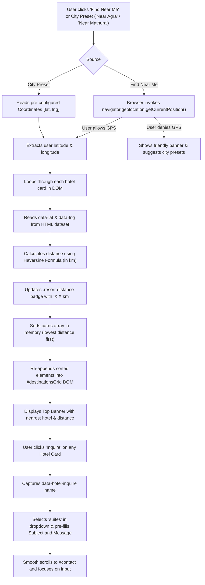

# Technical Guide & Viva Reference: "Find Near Me" & Geolocation Flow

> **Project:** Hotel & Spa Adina — Resort Management System  
> **Author / Lead:** Deepanshu Kashyap  
> **Topic:** Geolocation API, Haversine Distance Calculation, Dynamic DOM Sorting & Auto-fill Contact Redirection  

---

## 1. Executive Summary & User Flow



---

## 2. Architecture & Data Attributes in HTML

Har hotel card me HTML5 **`data-*` attributes** ka use karke coordinates aur inquiry data store kiya gaya hai.

### Sample Hotel Card (`index.html`):

```html
<!-- The Oberoi Amarvilas (Agra) -->
<div class="col-12 col-md-6 col-lg-3 dest-item" 
     data-destination="agra" 
     data-lat="27.1705" 
     data-lng="78.0496">

  <article class="resort-card">
    <div class="resort-card-img-wrap">
      
      <span class="resort-city-badge agra">Agra</span>
      <span class="resort-rating-badge"><i class="bi bi-star-fill"></i> 4.9</span>
      
      <!-- Distance badge starts hidden (d-none), populated by JS -->
      <span class="resort-distance-badge d-none"></span>
    </div>

    <div class="resort-card-body">
      <p class="resort-category">Ultra-Luxury Heritage</p>
      <h3 class="resort-title">The Oberoi Amarvilas</h3>
      <p class="resort-location-line">
        <i class="bi bi-geo-alt"></i> 600m from Taj Mahal, Agra
      </p>
      <p class="resort-desc">
        World-acclaimed palace resort offering uninterrupted views of the Taj Mahal...
      </p>

      <div class="resort-card-footer">
        <div>
          <div class="resort-price-tag">From</div>
          <div class="resort-price-val">rs.18,500 <small>/night</small></div>
        </div>
        
        <!-- Button with custom data-hotel-inquire attribute -->
        <a href="#contact" class="btn-custom btn-custom-sm btn-dark" 
           data-hotel-inquire="The Oberoi Amarvilas, Agra">
          Inquire
        </a>
      </div>
    </div>
  </article>
</div>
```

### Kyon use kiya `data-*` attributes?
1. **Separation of Concerns:** Coordinates (`data-lat`, `data-lng`) HTML structure ko bina disturb kiye directly DOM nodes se read ho jaate hain via `getAttribute('data-lat')` ya `element.dataset.lat`.
2. **Zero Backend Dependency:** Pure client-side static project hone ke bawajood dynamic behavior milta hai.

---

## 3. Step-by-Step JavaScript Code Breakdown (`js/booking.js`)

Sabhi logic [`js/booking.js`](file:///c:/Users/Deepanshu/Desktop/miniproject/Hotel-Booking-Landing-Page--React-Frontend-main/js/booking.js) me likhi gayi hai. Har function ka role niche detailed hai:

---

### Step A: Browser Geolocation API (`navigator.geolocation`)

```javascript
var btnDetectLocation = document.getElementById('btnDetectLocation');

if (btnDetectLocation) {
  btnDetectLocation.addEventListener('click', function () {
    // 1. Check if browser supports Geolocation
    if (!navigator.geolocation) {
      alert('Geolocation is not supported by your browser.');
      return;
    }

    btnDetectLocation.innerHTML = '<i class="bi bi-hourglass-split"></i> Detecting GPS...';

    // 2. Request current location coordinates
    navigator.geolocation.getCurrentPosition(
      // Success Callback: runs when user clicks "Allow"
      function (pos) {
        btnDetectLocation.classList.add('active');
        btnDetectLocation.innerHTML = '<i class="bi bi-geo-alt-fill"></i> Location Active';
        
        // pos.coords contains latitude and longitude from device GPS/WiFi
        applyLocationSort(pos.coords.latitude, pos.coords.longitude, 'Your GPS Location');
      },
      // Error Callback: runs if user clicks "Block" or GPS timeout happens
      function (err) {
        btnDetectLocation.innerHTML = '<i class="bi bi-crosshair"></i> Find Near Me';
        locationStatusText.innerHTML = 
          '<strong>Location access denied or unavailable.</strong> You can click the preset chips (Near Agra / Near Mathura) to test distance sorting.';
        locationStatusBanner.classList.remove('d-none');
      },
      // Options object: High accuracy and 8-second timeout
      { enableHighAccuracy: true, timeout: 8000 }
    );
  });
}
```

#### Explanation to give in Viva:
> *"Hum HTML5 ka built-in `navigator.geolocation.getCurrentPosition()` method use kar rahe hain. Isme do mandatory callbacks hote hain — `successCallback` aur `errorCallback`. Success hone par hame `pos.coords.latitude` aur `pos.coords.longitude` milte hain jo hum distance calculation function ko pass karte hain."*

---

### Step B: Offline / Presentation Fallback Presets

College presentation ke time browser GPS permission mangne par deny ho sakta hai, ya evaluator offline ho sakta hai. Iske liye humne 3 fixed city presets diye hain:

```javascript
var cityCoords = {
  agra: { lat: 27.1767, lng: 78.0081, name: 'Agra City Center' },
  mathura: { lat: 27.4924, lng: 77.6737, name: 'Mathura - Vrindavan' },
  delhi: { lat: 28.6139, lng: 77.2090, name: 'Delhi-NCR' }
};

presetLocChips.forEach(function (chip) {
  chip.addEventListener('click', function () {
    var cityKey = this.getAttribute('data-test-loc'); // 'agra', 'mathura', or 'delhi'
    var city = cityCoords[cityKey];
    if (!city) return;

    presetLocChips.forEach(function (c) { c.classList.remove('active'); });
    this.classList.add('active');

    // Run same calculation pipeline with city coordinates
    applyLocationSort(city.lat, city.lng, city.name);
  });
});
```

---

### Step C: Haversine Distance Calculation Formula

Earth flat nahi balki sphere hai. Do GPS points (Latitude, Longitude) ke beech curved surface par straight-line distance calculate karne ke liye **Haversine Formula** standard method hai.

$$\Delta\text{lat} = \text{lat}_2 - \text{lat}_1, \quad \Delta\text{lon} = \text{lon}_2 - \text{lon}_1$$

$$a = \sin^2\left(\frac{\Delta\text{lat}}{2}\right) + \cos(\text{lat}_1) \cdot \cos(\text{lat}_2) \cdot \sin^2\left(\frac{\Delta\text{lon}}{2}\right)$$

$$c = 2 \cdot \text{atan2}\left(\sqrt{a}, \sqrt{1-a}\right), \quad d = R \cdot c \quad (R = 6371\text{ km})$$

#### Implementation:
```javascript
function getDistanceKm(lat1, lon1, lat2, lon2) {
  var R = 6371; // Earth's mean radius in Kilometers
  
  // Convert degree differences to radians: rad = deg * (PI / 180)
  var dLat = (lat2 - lat1) * Math.PI / 180;
  var dLon = (lon2 - lon1) * Math.PI / 180;
  
  var a = Math.sin(dLat / 2) * Math.sin(dLat / 2) +
          Math.cos(lat1 * Math.PI / 180) * Math.cos(lat2 * Math.PI / 180) *
          Math.sin(dLon / 2) * Math.sin(dLon / 2);
          
  var c = 2 * Math.atan2(Math.sqrt(a), Math.sqrt(1 - a));
  
  // Return distance rounded to 1 decimal place (e.g. 4.2 km)
  return Math.round(R * c * 10) / 10;
}
```

---

### Step D: Calculating, Updating Badges, and Sorting Cards in DOM

```javascript
function applyLocationSort(userLat, userLng, placeLabel) {
  if (!destGrid) return;

  // 1. Loop through all 8 hotel cards
  destItems.forEach(function (card) {
    var lat = parseFloat(card.getAttribute('data-lat'));
    var lng = parseFloat(card.getAttribute('data-lng'));
    var distBadge = card.querySelector('.resort-distance-badge');

    if (!isNaN(lat) && !isNaN(lng)) {
      // Calculate distance from user position
      var dist = getDistanceKm(userLat, userLng, lat, lng);
      
      // Store distance directly on DOM object property for sorting
      card._dist = dist;

      // Update UI badge inside card image
      if (distBadge) {
        distBadge.innerHTML = '<i class="bi bi-geo-alt-fill"></i> ' + 
                              (dist < 1 ? '<1 km' : dist + ' km');
        distBadge.classList.remove('d-none'); // Show badge
      }
    } else {
      card._dist = 999999;
    }
  });

  // 2. Sort array ascending by distance (lowest km first)
  var sorted = destItems.slice().sort(function (a, b) {
    return a._dist - b._dist;
  });

  // 3. Re-append nodes into parent grid
  // In DOM: appendChild() on an already-existing node moves it to the end.
  // Appending in sorted order re-orders the actual layout visually!
  sorted.forEach(function (card) {
    destGrid.appendChild(card);
  });

  // 4. Update the summary banner at top
  if (locationStatusBanner && locationStatusText && sorted.length > 0) {
    var nearestName = sorted[0].querySelector('.resort-title').textContent;
    var nearestDist = sorted[0]._dist;

    locationStatusText.innerHTML =
      'Showing <strong>' + sorted.length + ' resorts</strong> sorted nearest to <strong>' + placeLabel + '</strong>. ' +
      'Nearest: <strong>' + nearestName + '</strong> (' + (nearestDist < 1 ? '<1 km' : nearestDist + ' km away') + ')';

    locationStatusBanner.classList.remove('d-none');
  }

  // 5. Reveal Reset button
  if (btnResetLocation) {
    btnResetLocation.classList.remove('d-none');
  }
}
```

> [!TIP]
> **JavaScript Concept to Remember:**  
> Jab hum `destGrid.appendChild(existingElement)` karte hain, toh element duplicate nahi hota — balki browser use uske naye sorted sequence me shift kar deta hai. Yeh DOM manipulation ka sabse fast aur memory-efficient tarika hai!

---

### Step E: Redirection & Auto-Filling Contact Form

User jab kisi bhi resort card par **"Inquire"** button dabata hai, toh script user ko bina reload kiye Contact section par scroll karti hai aur fields ko pre-fill kar deti hai:

```javascript
var inquireButtons = document.querySelectorAll('[data-hotel-inquire]');

inquireButtons.forEach(function (btn) {
  btn.addEventListener('click', function () {
    // 1. Read hotel name from data-hotel-inquire attribute
    var hotelName = this.getAttribute('data-hotel-inquire');
    
    // 2. Find target form inputs in #contact section
    var serviceSelect = document.getElementById('contact-service');
    var subjectInput = document.getElementById('contact-subject');
    var messageTextarea = document.getElementById('contact-message');

    // 3. Auto-select category: 'suites' (Room & Suite Reservation)
    if (serviceSelect) {
      serviceSelect.value = 'suites';
    }

    // 4. Pre-fill subject line
    if (subjectInput && hotelName) {
      subjectInput.value = 'Inquiry for ' + hotelName;
    }

    // 5. Pre-fill professional message template
    if (messageTextarea && hotelName) {
      messageTextarea.value = 
        'Hello Concierge, I would like to inquire about reservation availability and rates for ' + 
        hotelName + '.';
    }

    // 6. Smooth scroll to contact form
    var contactSec = document.getElementById('contact');
    if (contactSec) {
      contactSec.scrollIntoView({ behavior: 'smooth', block: 'start' });
      
      // Auto-focus the subject input after scroll finishes
      setTimeout(function () {
        if (subjectInput) subjectInput.focus();
      }, 500);
    }
  });
});
```

---

## 4. Reset Functionality

Agar user ko normal default view par wapas jaana ho:

```javascript
function resetLocation() {
  if (!destGrid) return;

  // Re-append cards in original non-distance order
  originalDestOrder.forEach(function (card) {
    card._dist = null;
    var distBadge = card.querySelector('.resort-distance-badge');
    if (distBadge) distBadge.classList.add('d-none');
    destGrid.appendChild(card);
  });

  // Hide status banner and reset button
  if (locationStatusBanner) locationStatusBanner.classList.add('d-none');
  if (btnResetLocation) btnResetLocation.classList.add('d-none');
  
  if (btnDetectLocation) {
    btnDetectLocation.classList.remove('active');
    btnDetectLocation.innerHTML = '<i class="bi bi-crosshair"></i> Find Near Me';
  }

  presetLocChips.forEach(function (chip) { chip.classList.remove('active'); });
  filterDestinations();
}
```

---

## 5. Cheat Sheet: How to Explain in Presentation / Viva

| Question Evaluator Might Ask | Quick Crisp Answer |
| :--- | :--- |
| **"Nearby hotel kaise dhoondh rahe ho?"** | *"Hum HTML5 Geolocation API (`navigator.geolocation.getCurrentPosition`) se user ke live coordinates (latitude aur longitude) lete hain, aur har hotel ke stored coordinates ke beech Haversine formula se distance calculate karte hain."* |
| **"Hotel ke coordinates kahan store hain?"** | *"Har card ke HTML element par custom data attributes `data-lat` aur `data-lng` ke roop me embedded hain (e.g. `27.1705, 78.0496` for Oberoi Amarvilas)."* |
| **"Sorting kaise ho rahi hai bina database ke?"** | *"JavaScript me cards ko ek Array me convert karke `Array.prototype.sort()` chalate hain: `a._dist - b._dist` (ascending order). Fir sorted elements ko parent container me `appendChild()` se re-append karte hain, jisse browser visually closest hotel ko sabse pehle show karta hai."* |
| **"Agar user location allow na kare toh kya hoga?"** | *"Humne graceful fallback diya hai: error callback trigger hota hai jo polite message dikhata hai, aur sath hi 'Near Agra', 'Near Mathura', aur 'Near Delhi' ke 1-click simulation buttons diye hain jisse project bina GPS permission ke bhi test aur demonstrate ho sakta hai."* |
| **"Inquire click karne par Contact form kaise bhar jata hai?"** | *"Har button par `data-hotel-inquire` attribute laga hai. Click listener us value ko pick karke `#contact-subject` aur `#contact-message` ki `.value` set karta hai aur `scrollIntoView({ behavior: 'smooth' })` se page ko contact section par smoothly scroll kar deta hai."* |

---

## 6. Verification Checklist for Demo

- [x] Click **"Find Near Me"** → Browser prompts for location; on allow, cards sort with green distance badges (e.g. `4.2 km`).
- [x] Click **"Near Agra"** → Oberoi Amarvilas & ITC Mughal shift to the first positions (~0.8 km - 2.5 km away).
- [x] Click **"Near Mathura"** → Kadamb Resort & Radha Ashok shift to the first positions (~1.2 km away).
- [x] Click **"Reset"** → Grid returns to original curated layout; badges hide.
- [x] Click **"Inquire"** on any card → Smooth scroll down to `#contact`, dropdown switches to `Room & Suite Reservation`, subject shows `Inquiry for [Hotel Name]`, and cursor is focused.
